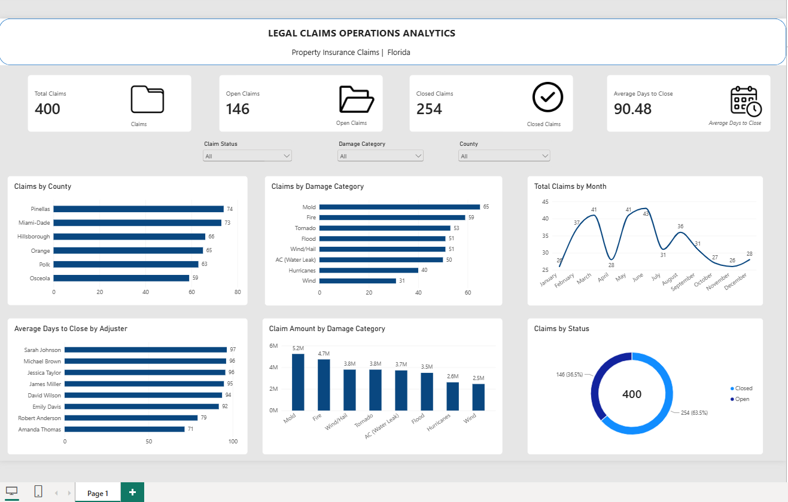

# 📊 Legal Claims Operations Analytics — Python, Pandas & Power BI

## 📌 Project Overview

This project analyzes a synthetic property insurance claims dataset to evaluate claims operations, processing times, claim amounts, and workload distribution.

Python and Pandas were used to inspect, clean, and prepare the dataset. Power BI was used to build an interactive dashboard to visualize operational metrics and identify patterns across counties, damage categories, insurance companies, and adjusters.

The objective is to demonstrate a complete data analytics workflow, from data quality assessment and cleaning to visualization and business insights.

## 🎯 Business Questions

- How many claims are currently open and closed?
- What is the average time required to close a claim?
- Which counties have the highest number of claims?
- Which damage categories account for the highest claim amounts?
- How is the workload distributed across adjusters?
- How do claim volumes change over time?

## 🛠️ Tools & Technologies

- **Python** — Data inspection and cleaning
- **Pandas** — Data manipulation and transformation
- **Google Colab** — Python development environment
- **Power BI** — Interactive dashboard and visualizations
- **DAX** — KPI calculations and measures
- **Excel** — Dataset storage and preparation
- **Data Quality** — Duplicate detection, missing values, standardization, and date validation

## 🧹 Data Cleaning Process

The original dataset contained 405 records. The cleaning process included:

- Identifying and removing 5 duplicate Claim IDs.
- Standardizing county and insurance company names.
- Identifying missing dates and claim amounts.
- Identifying invalid date sequences.
- Preserving missing and invalid values for data quality review rather than inventing replacement values.

The cleaned dataset contains 400 unique claim records.

## 📊 Power BI Dashboard

The interactive dashboard includes:

- Total Claims
- Open Claims
- Closed Claims
- Average Days to Close
- Claims by County
- Claims by Damage Category
- Claim Amount by Damage Category
- Claims by Status
- Average Days to Close by Adjuster
- Monthly Claims Trend

## 🧠 Key Insights

- **Total Claims:** 400
- **Open Claims:** 146
- **Closed Claims:** 254
- **Average Days to Close:** 90.48 days

The average processing time was calculated using closed claims with valid opening and closing dates.

Additional analysis highlights differences in claim volume and amounts across counties and damage categories.

## 📷 Dashboard Preview

## 📁 Project Structure

- `Legal_Claims_Operations_Analytics.pbix` — Power BI report
- `Legal_Claims_Raw_Data.xlsx` — Original synthetic dataset
- `Legal_Claims_Cleaned.xlsx` — Cleaned dataset
- `Notebooks/` — Python data cleaning notebook
- `Images/` — Dashboard screenshot

## 💡 Skills Demonstrated

- Data cleaning and preprocessing
- Data quality assessment
- Exploratory data analysis
- Python and Pandas
- Power BI dashboard development
- DAX measures
- KPI reporting
- Operational data analysis

**Note:** This project uses synthetic data created for portfolio and educational purposes. It does not contain real customer or insurance claim records.
